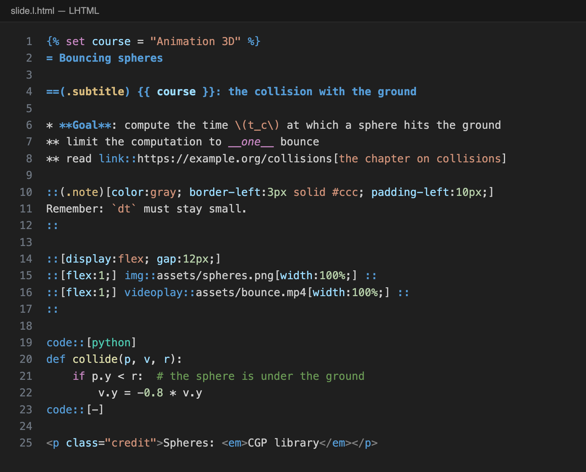

# LHTML for Visual Studio Code

Syntax highlighting, folding and snippets for [LHTML](https://scholartools.fr/lhtml/), the light
markup over HTML, and for the pages of [lhtml-site](https://github.com/drohmer/lhtml-site).



## What it does

- **Highlighting of the LHTML marks**: titles `=`, items `*`, bold `**` and italic `__`, inline
  code, and the `::` system with its groups: classes and id `(.note #intro)`, a style `[...]`
  highlighted as CSS, attributes `{...}`. `link::`, `img::`, `video::` and `videoplay::` show their
  URL and label. The groups may come in any order, as LHTML reads them.
- **Everything else is HTML**, highlighted as HTML: tags, `<style>`, `<script>`, comments.
- **Code blocks** `code::[python]` ... `code::[-]` are highlighted in their language (Python, C++,
  JavaScript, shell, JSON, YAML, CSS, HTML, LaTeX...), and nothing in them is read as LHTML.
- **Jinja** `{{ ... }}`, `` and `{# ... #}`, also inside HTML attributes and `[...]` styles.
- **Math** `\( ... \)` and `\[ ... \]` (LHTML reads a `$` as text: `$$ a__b__ $$` gets an italic).
- **Folding** of the blocks opened by `name::` or `::[...]` and closed by `::`, and of code blocks
  (`gap::`, the empty macro of the lhtml-site themes, opens none).
- **Snippets**: `div::`, `::[`, `span::`, `cols`, `link::`, `img::`, `video::`, `videoplay::`, `code::`,
  `{% for`.

The rules follow LHTML: `std::vector`, `obj.link::x` or the slice `a[::2]` stay text.

## Files

The extension applies to:

- `*.l.html` and `*.lhtml`, the files of the `lhtml` command;
- `index.html.j2` under a `src/` directory: the pages of an lhtml-site project.

For other files, choose **LHTML** in the language picker of the status bar, or associate them in
your settings:

```json
"files.associations": {
  "*.html.j2": "lhtml"
}
```

## Install

The extension is not on the Marketplace yet. From the repository:

```bash
cd editors/vscode
npx @vscode/vsce package
code --install-extension lhtml-*.vsix
```

## License

MIT, like LHTML.
