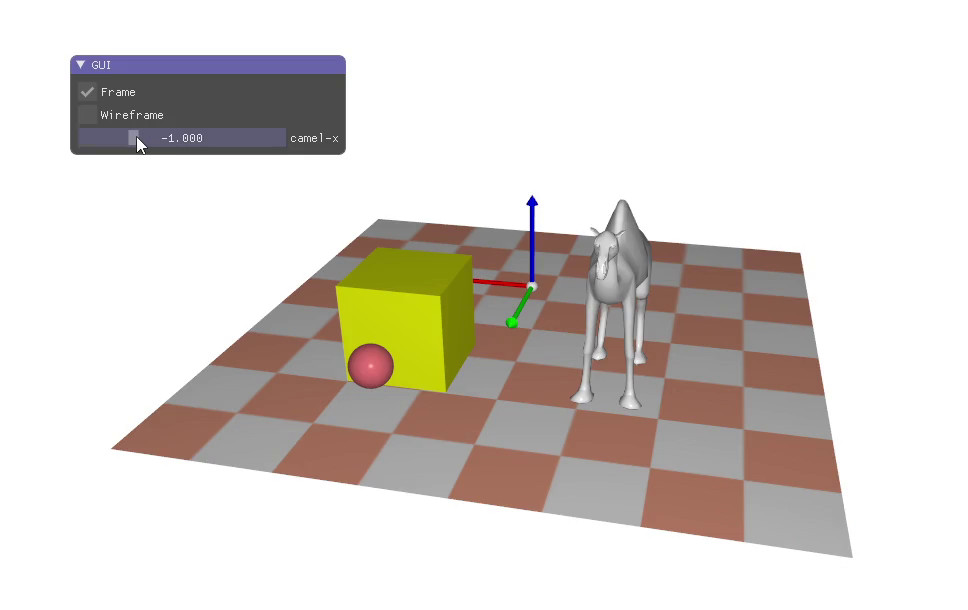

# LHTML Examples

Install LHTML (`pipx install lhtml-markup` for the command, or `pip install lhtml-markup` in a virtual environment; see [Installation](../README.md#installation)), then run the examples from this directory:

```shell
lhtml example_1.l.html                  # HTML on stdout
lhtml example_1.l.html -o example_1.html
lhtml example_1.l.html -w               # Full HTML document
lhtml example_1.l.html example_video.l.html   # example_1.html, example_video.html
lhtml slide.l.html lab_page.l.html -w   # two complete pages, to open in a browser
```

The first two show the syntax one construct at a time; `slide.l.html` and
`lab_page.l.html` are written as a slide and a lab page of a course
usually are, with the styles written in the page.


## example_1.l.html

Headings, a list and a styled div:

```
= Main Title

== Subtitle

* First point
* Second point
* Third point

::[color:red;]
This text should be red
::
```

`lhtml example_1.l.html` generates:

```html
<h1>Main Title</h1>


<h2>Subtitle</h2>


<ul>
<li>
First point
</li>
<li>
Second point
</li>
<li>
Third point
</li>
</ul>

<div style="color:red;">
This text should be red
</div>
```


## example_video.l.html

An image and a video. `videoplay::` adds `autoplay loop muted playsinline`; the poster is an attribute written in `{}`:

```
img::assets/video-poster.jpg[width:400px;]

videoplay::assets/video.mp4{poster="assets/video-poster.jpg"}[width:400px;]
```

`lhtml example_video.l.html` generates:

```html


<video poster="assets/video-poster.jpg" autoplay loop muted playsinline style="width:400px;">
	<source src="assets/video.mp4" type="video/mp4">
	 Cannot play video assets/video.mp4
</video>
```


## slide.l.html

A slide: a title, a list (an item may start with `-` or `(+)`, kept as
text), vertical spaces written `div::[height:25px;]::`, a block placed at a
position of the slide (`position:fixed; top:...; left:...`), math kept for
KaTeX or MathJax (`\(p' = R(\theta)\,p\)`), and a centered video with
its caption, small and gray:

```
div::[text-align:center;]
videoplay::assets/video.mp4[width:400px;]
div::[font-size:75%; color:gray;]__Example of animation__ ::
::
```

The positions assume the size of a slide, which the theme of a deck gives
(see [lhtml-site](https://github.com/drohmer/lhtml-site)); in a plain page
of `lhtml -w` the block is placed in the window. The math needs KaTeX or
MathJax in the page, as a deck or a site of lhtml-site loads them.


## lab_page.l.html

A lab page: the path of the code in gray, a paragraph with `<br>`,
instructions as a list with math and inline code, a C++ code block, a link,
and the expected result as a centered video. The code is colored by a
Pygments stylesheet ([Code Blocks](../README.md#code-blocks)).

In a site of lhtml-site, the same content is the body of a page
`index.html.j2`, between `` and ``
... ``.
